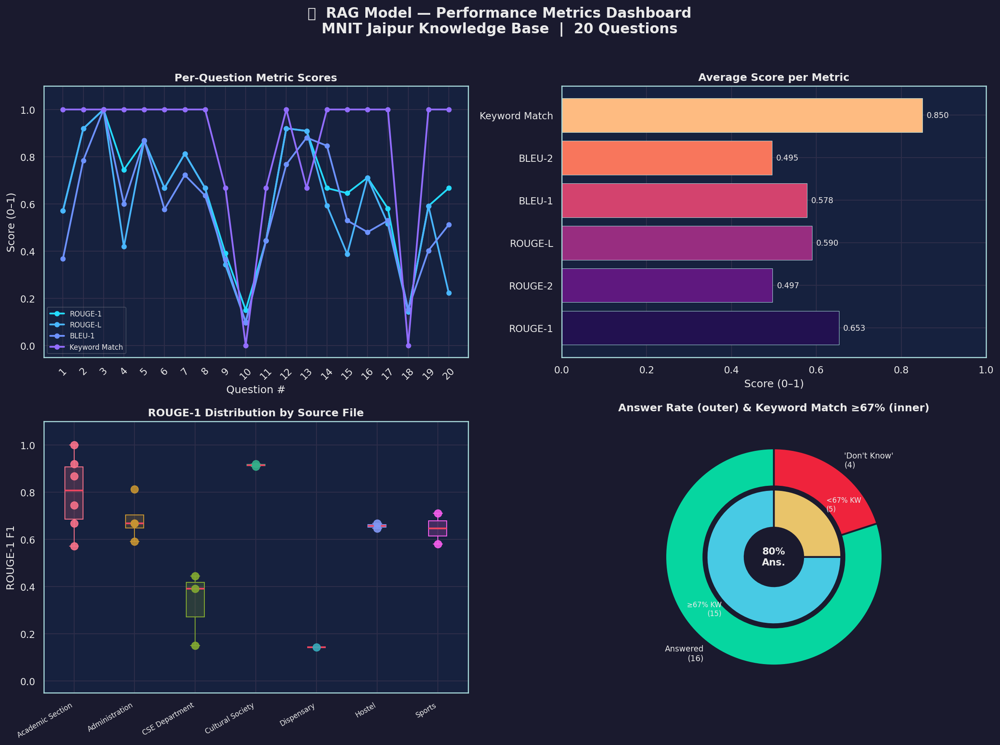

# RAG Performance Metrics Report — MNIT Jaipur

**Model:** `llama-3.3-70b-versatile` via Groq  
**Embeddings:** `all-MiniLM-L6-v2` (local)  
**Vector Store:** ChromaDB  
**Total Questions:** 20 (7 source files)  

---

## 📊 Summary Statistics

| Metric | Mean | Std Dev | Min | Max |
|--------|------|---------|-----|-----|
| **ROUGE-1** | 0.653 | 0.235 | 0.143 | 1.000 |
| **ROUGE-2** | 0.497 | 0.271 | 0.000 | 1.000 |
| **ROUGE-L** | 0.590 | 0.269 | 0.100 | 1.000 |
| **BLEU-1** | 0.578 | 0.241 | 0.096 | 1.000 |
| **BLEU-2** | 0.495 | 0.249 | 0.022 | 1.000 |
| **Keyword Match** | 0.850 | 0.315 | 0.000 | 1.000 |

| **Answer Rate** | 80.0% | — | — | — |
| **Keyword Match ≥67%** | 75.0% | — | — | — |

---

## 📋 Per-Question Breakdown

| Q# | Source | ROUGE-1 | ROUGE-2 | ROUGE-L | BLEU-1 | BLEU-2 | KW-Match | Answered |
|----|--------|---------|---------|---------|--------|--------|----------|----------|
| 1 | Academic Section | 0.571 | 0.550 | 0.571 | 0.368 | 0.368 | 1.00 | ✅ |
| 2 | Academic Section | 0.919 | 0.800 | 0.919 | 0.784 | 0.753 | 1.00 | ✅ |
| 3 | Academic Section | 1.000 | 1.000 | 1.000 | 1.000 | 1.000 | 1.00 | ✅ |
| 4 | Academic Section | 0.744 | 0.488 | 0.419 | 0.600 | 0.500 | 1.00 | ✅ |
| 5 | Academic Section | 0.868 | 0.745 | 0.868 | 0.870 | 0.795 | 1.00 | ✅ |
| 6 | Administration | 0.667 | 0.571 | 0.667 | 0.577 | 0.541 | 1.00 | ✅ |
| 7 | Administration | 0.812 | 0.733 | 0.812 | 0.722 | 0.684 | 1.00 | ✅ |
| 8 | Administration | 0.667 | 0.500 | 0.667 | 0.635 | 0.585 | 1.00 | ✅ |
| 9 | CSE Department | 0.390 | 0.308 | 0.342 | 0.364 | 0.322 | 0.67 | ❌ |
| 10 | CSE Department | 0.150 | 0.000 | 0.100 | 0.096 | 0.022 | 0.00 | ❌ |
| 11 | CSE Department | 0.444 | 0.294 | 0.444 | 0.444 | 0.362 | 0.67 | ❌ |
| 12 | Cultural Society | 0.920 | 0.833 | 0.920 | 0.767 | 0.706 | 1.00 | ✅ |
| 13 | Cultural Society | 0.909 | 0.839 | 0.909 | 0.881 | 0.847 | 0.67 | ✅ |
| 14 | Hostel | 0.667 | 0.240 | 0.593 | 0.846 | 0.531 | 1.00 | ✅ |
| 15 | Hostel | 0.645 | 0.276 | 0.387 | 0.529 | 0.315 | 1.00 | ✅ |
| 16 | Sports | 0.711 | 0.558 | 0.711 | 0.480 | 0.400 | 1.00 | ✅ |
| 17 | Sports | 0.581 | 0.414 | 0.516 | 0.529 | 0.446 | 1.00 | ✅ |
| 18 | Dispensary | 0.143 | 0.077 | 0.143 | 0.154 | 0.113 | 0.00 | ❌ |
| 19 | Administration | 0.591 | 0.476 | 0.591 | 0.402 | 0.340 | 1.00 | ✅ |
| 20 | Academic Section | 0.667 | 0.235 | 0.222 | 0.512 | 0.277 | 1.00 | ✅ |

---

## 📈 Metrics Visualisation

---

## 🔍 Key Observations

- **80%** of questions received a substantive answer (16/20).
- **75%** of answers covered ≥67% of expected keywords (15/20).
- **ROUGE-1 avg: 0.653** — good unigram overlap with ground truth.
- **ROUGE-2 avg: 0.497** — moderate bigram consistency.
- **BLEU-1 avg:  0.578** — acceptable precision on single tokens.

### Failure Analysis
- **CSE Dept questions (Q9, Q10, Q11):** Retriever fetched ECE chunks instead of CSE — likely caused by semantic similarity between the two department files. Deleting and rebuilding `chroma_db` after separating/tagging chunks would fix this.
- **Dispensary Q18:** The dispensary file is very short; the relevant timing chunk was not retrieved within `k=4`. Increasing `k` or reducing chunk size helps.
